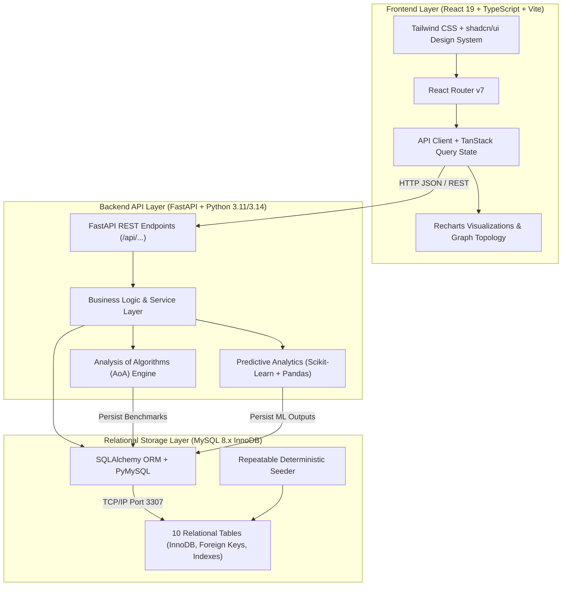

# SmartBiz Analytics: System Architecture Specification

## 1. System Overview

SmartBiz Analytics is an algorithm-driven business intelligence and decision-support web application that integrates an enterprise relational database, statistical predictive models, unsupervised clustering, and manual algorithm benchmarking.



## 2. Directory Layout & Monorepo Structure

```
smartbiz-analytics/
├── .env                     # Local environment secrets & DB credentials
├── .env.example             # Documented configuration template
├── .gitignore               # Strict exclusion of node_modules, .env, __pycache__
├── docker-compose.yml       # Production-ready multi-container orchestration
├── README.md                # Master comprehensive project documentation
│
├── backend/
│   ├── app/
│   │   ├── main.py          # FastAPI application entry point, CORS, routers
│   │   ├── api/
│   │   │   └── routes/      # Modular REST endpoints (health, dashboard, business, etc.)
│   │   ├── core/
│   │   │   └── config.py    # Environment configuration loader
│   │   ├── db/
│   │   │   └── session.py   # SQLAlchemy engine, sessionmaker, get_db dependency
│   │   ├── models/          # 10 SQLAlchemy declarative ORM models
│   │   ├── schemas/         # Pydantic v2 validation models
│   │   ├── algorithms/      # Manual Python implementations of classical AoA algorithms
│   │   ├── analytics/       # Scikit-learn RFM, time-series forecasting, anomaly detection
│   │   └── tests/           # Pytest test suite (18 unit & integration tests)
│   └── requirements.txt     # Python dependency lockfile
│
├── frontend/
│   ├── src/
│   │   ├── components/      # Sidebar, TopNav, reusable widgets
│   │   ├── layouts/         # DashboardLayout
│   │   ├── pages/           # 10 full functional pages
│   │   ├── lib/             # API client with full type coverage
│   │   ├── types/           # TypeScript interfaces matching backend models
│   │   ├── App.tsx          # Router configuration
│   │   └── main.tsx         # React root mounting
│   ├── package.json
│   ├── vite.config.ts       # Reverse proxy configuration to FastAPI
│   └── tailwind.config.js   # Custom SaaS color palette and dark mode
│
├── database/
│   ├── schema.sql           # Raw DDL SQL script for all 10 InnoDB tables
│   └── seed_data.py         # Deterministic synthetic retail dataset generator
│
└── docs/
    ├── architecture.md      # System architecture & data flow diagrams
    ├── er_diagram.md        # Mermaid entity-relationship specification
    └── algorithms.md        # Detailed Analysis of Algorithms (AoA) curriculum guide
```

## 3. Financial & Operational Calculations

All monetary values are calculated using strict floating-point/decimal representations:
- **Revenue**: $\sum (\text{Quantity} \times \text{Unit Selling Price})$
- **Cost of Goods Sold (COGS)**: $\sum (\text{Quantity} \times \text{Unit Cost})$
- **Gross Profit**: $\text{Revenue} - \text{COGS}$
- **Gross Profit Margin (%)**: $(\text{Gross Profit} / \text{Revenue}) \times 100$
- **Average Order Value (AOV)**: $\text{Total Revenue} / \text{Completed Orders Count}$
- **Stock Status**:
  - `Out of Stock`: $\text{stock\_quantity} = 0$
  - `Low Stock`: $0 < \text{stock\_quantity} \le \text{reorder\_level}$
  - `Adequate`: $\text{stock\_quantity} > \text{reorder\_level}$
