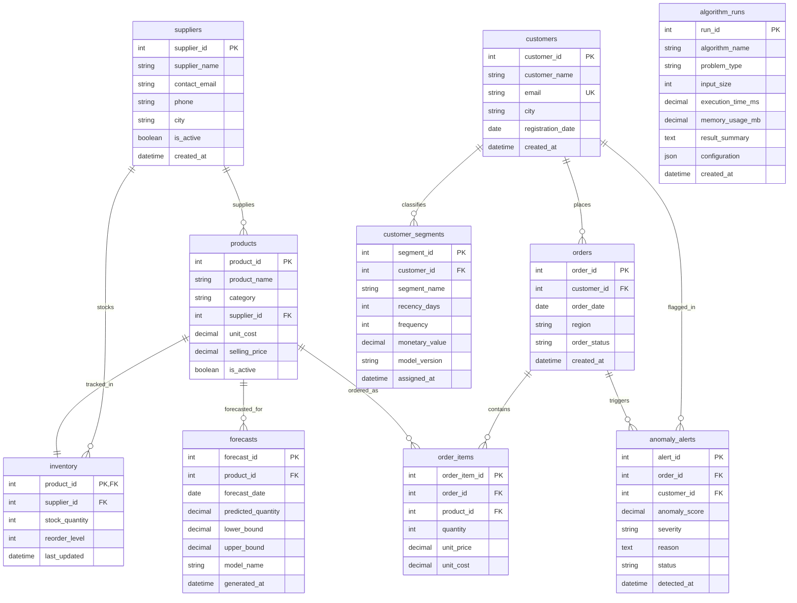

# SmartBiz Analytics: Entity-Relationship (ER) Diagram

The following Mermaid diagram models all ten core relational database tables in SmartBiz Analytics, their primary and foreign key constraints, relationship cardinalities, and key column types.

